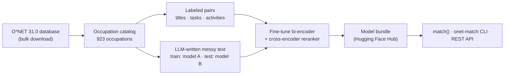

# onet-match

[](https://pypi.org/project/onet-match/) [](https://doi.org/10.5281/zenodo.23824326) [](https://registry.modelcontextprotocol.io/v0.1/servers?search=io.github.Benjamin-V-Chan/onet-match) [](https://huggingface.co/spaces/BenjaminChan12/onet-match)

**Map free text about work to O\*NET occupations.** Job titles, resume
bullets, job postings, project descriptions, interest statements and skill
lists go in. Ranked O\*NET-SOC occupations come out, each with key tasks,
skills, knowledge, RIASEC interests and a calibrated confidence score.

- **[Try it in your browser](https://huggingface.co/spaces/BenjaminChan12/onet-match)**: no install, and the model runs on your device.
- Open source (MIT) and runs locally. No API key or account needed to match.
- Fine-tuned bi-encoder + cross-encoder reranker over all 923 O\*NET 31.0
  occupations. Top-1 accuracy is **51%** on held-out O\*NET text and **65%** on
  messy human-style text, vs 21% and 17% for a TF-IDF baseline.
- Python API, CLI, REST API (FastAPI), MCP server for AI assistants, and
  Docker. About 47 ms per query on a laptop.
- Also includes the O\*NET data pipeline it's built on: bulk database download,
  a Web Services client and analysis tools.

| use case | input | top match (confidence) |
|---|---|---|
| Career exploration | `designed our robot in CAD and wired its circuits for my high school robotics team` | Robotics Engineers, 17-2199.08 (0.38); #2 Robotics Technicians |
| Career exploration | `I love weather, maps and tracking storms` | Atmospheric and Space Scientists, 19-2021.00 (0.87) |
| Skills-based hiring | `Must know survival analysis, R, SAS and clinical trial data` | Biostatisticians, 15-2041.01 (0.60) |
| Skills-based hiring | `Must know Solidity, smart contracts and Ethereum` | Blockchain Engineers, 15-1299.07 (0.81) |
| Resume parsing | `Led a team of 12 nurses on a cardiac ICU night shift` | Critical Care Nurses, 29-1141.03 (0.42); #2 Acute Care Nurses |
| Resume parsing | `Excel, QuickBooks, payroll, AP/AR` | Payroll and Timekeeping Clerks, 43-3051.00 (0.49) |
| Career counseling | `skills: Python, SQL, Tableau; interests: sports statistics` | Statisticians, 15-2041.00 (0.59) |
| Job-posting normalization | `{"title": "Wind Turbine Tech", "requirements": ["climbing", "hydraulics", "electrical troubleshooting"]}` | Wind Turbine Service Technicians, 49-9081.00 (0.81) |

Real outputs of the served model, saved in `outputs/examples/readme_examples.json`.

## Quickstart

```bash
pip install "onet-match[matching]"
```

```python
from onet_match import match

result = match("Must know survival analysis, R, SAS and clinical trial data", top_k=5)
for m in result.matches:
    print(m.soc, m.title, m.confidence)
print(result.profile["riasec_code"])      # aggregate interest code, e.g. "ICS"
```

The package imports as `onet_match` and provides the `onet-match` command.
The first call downloads the pretrained model bundle (about 0.5 GB) from the
Hugging Face Hub ([BenjaminChan12/onet-match](https://huggingface.co/BenjaminChan12/onet-match)) and caches it.

```bash
onet-match match "Excel, QuickBooks, payroll, AP/AR"          # CLI (add --json for JSON)
pip install "onet-match[matching,serve]"
onet-match serve --port 8000                                   # REST API
curl -s localhost:8000/match -H 'content-type: application/json' \
     -d '{"text": "I love weather, maps and tracking storms", "top_k": 3}'
```

REST routes: `POST /match`, `POST /match/batch`, `GET /occupation/{soc}` and
`GET /health`. The full request and response contract and the Docker setup are
in [docs/API.md](https://github.com/Benjamin-V-Chan/onet-match/blob/main/docs/API.md).

### Use from AI assistants (MCP)

<!-- mcp-name: io.github.Benjamin-V-Chan/onet-match -->

`onet-match mcp` runs a [Model Context Protocol](https://modelcontextprotocol.io)
server with two read-only tools: `match_occupations(text, top_k)` and
`get_occupation(soc)`. Add it to any MCP client (Claude Desktop, Cursor, VS
Code and others):

```json
{
  "mcpServers": {
    "onet-match": {
      "command": "uvx",
      "args": ["--from", "onet-match[mcp]", "onet-match", "mcp"]
    }
  }
}
```

Without [uv](https://docs.astral.sh/uv/), run `pip install "onet-match[mcp]"` and
use `"command": "onet-match", "args": ["mcp"]`. For a remote server, use
`onet-match mcp --transport streamable-http --port 8001`.

### What each match contains

`soc`, `title`, `confidence` (calibrated, 0–1), `score`, `major_group` and its
title, `job_zone`, `riasec_code`, `description`, `top_tasks`, `top_skills`
and `top_knowledge` (with O\*NET importance and level). Each result also
carries a `profile` that aggregates skills, knowledge and all six RIASEC
interests across the matches, weighted by confidence.

## Use cases

- **Career exploration (EdTech).** Map what students say they did or enjoy to
  occupations and skills.
- **Resume and profile parsing.** Code experience bullets and skill lists to
  SOC codes.
- **Skills-based hiring and workforce planning.** Turn a list of required
  skills into the roles that use them, to scope a job or find adjacent talent.
- **Job-posting normalization.** Turn informal titles and descriptions into
  standard occupations.
- **Workforce and labor-market analytics.** Batch-code large text collections.
- **Career counseling tools.** Show the tasks and skills behind a suggestion.
- **LLM agents.** Ground occupation questions in O\*NET instead of free
  generation (see [`llms.txt`](https://github.com/Benjamin-V-Chan/onet-match/blob/main/llms.txt)).

Worked example: [onet-match-job-postings](https://github.com/Benjamin-V-Chan/onet-match-job-postings)
codes 3,000 LinkedIn job postings and compares pay by occupation group.

Details and integration patterns: [docs/APPLICATIONS.md](https://github.com/Benjamin-V-Chan/onet-match/blob/main/docs/APPLICATIONS.md).

## Accuracy

All models are evaluated on the same held-out splits. Every number traces to a
saved run in `outputs/runs/`.

| model | O\*NET test top-1 | O\*NET test top-5 | messy-text test top-1 | messy-text test top-5 | p50 latency |
|---|---|---|---|---|---|
| TF-IDF baseline | 20.5% | 40.5% | 17.4% | 39.2% | 0.5 ms |
| BM25 | 20.7% | 40.1% | 24.1% | 45.2% | 0.2 ms |
| bge-base-en-v1.5, off the shelf | 36.1% | 64.3% | 45.4% | 77.6% | 6.9 ms |
| fine-tuned bge-base | 50.2% | 78.2% | 65.2% | 92.6% | 6.8 ms |
| **fine-tuned bge-base + reranker (served)** | **51.1%** | **79.1%** | **65.4%** | **92.9%** | 46.7 ms |

- **O\*NET test:** 6,792 held-out titles, task statements, work activities and
  descriptions.
- **Messy-text test:** 4,703 informal snippets written by a different LLM than
  the one that wrote the training text.
- **Confidence:** temperature-calibrated, ECE 0.037.
- **Full results:** per-input-type tables, calibration, ablations, learning
  curves and error analysis are in [docs/RESULTS.md](https://github.com/Benjamin-V-Chan/onet-match/blob/main/docs/RESULTS.md).

## How it works



1. A fine-tuned bi-encoder (bge-base) embeds the input and retrieves the 20
   nearest occupations.
2. A fine-tuned cross-encoder rescores those 20.
3. The two scores are blended with a weight chosen on validation data.
4. A temperature-scaled softmax turns the blended scores into calibrated
   confidence.

The validation and test tasks are removed from the occupation documents the
models search, so no test text leaks into retrieval. Synthetic training and
test text come from different LLMs. Details are in
[docs/SYNTHETIC_DATA.md](https://github.com/Benjamin-V-Chan/onet-match/blob/main/docs/SYNTHETIC_DATA.md).

## In-browser demo

The [demo Space](https://huggingface.co/spaces/BenjaminChan12/onet-match) runs the same pipeline client-side with
[transformers.js](https://huggingface.co/docs/transformers.js): both models are
exported to ONNX and quantized to int8 (about 130 MB, cached after the first
visit). `demo/build.py` builds it from a bundle. Quantization and the browser
runtime shift results slightly: on 800 test queries the browser picks the same
top match as the Python package 95% of the time, with top-1 accuracy 61.5% vs
62.6% (`outputs/demo/browser_parity.json`). Use the Python package for anything
that matters.

## O\*NET data pipeline

The `onet_data_collector` package (`onet-collect`) downloads and verifies O\*NET
database releases, which needs no credentials. It also wraps O\*NET Web
Services: keyword search, occupation details and flattened profiles. See
[docs/COLLECTOR.md](https://github.com/Benjamin-V-Chan/onet-match/blob/main/docs/COLLECTOR.md).

```bash
onet-collect bulk download                         # download + verify the latest O*NET database
onet-match collect "healthcare" "technology"       # Web Services search (free O*NET account, see .env.example)
onet-match eda | keywords | cluster                # classic analysis: coverage, keyword attribution, TF-IDF clusters
```

## Train your own

```bash
git clone https://github.com/Benjamin-V-Chan/onet-match && cd onet-match
pip install -e ".[dev]"
onet-match matching build-data          # O*NET catalog, labeled pairs, splits
scripts/matching/reproduce.sh           # every model, ablation and the results report
onet-match matching bundle "<spec>" --run <run>   # package a model for serving
```

- **Synthetic text:** `WITH_SYNTH=1 TRAIN_LLM=<model> EVAL_PROVIDER=<provider> EVAL_LLM=<model> scripts/matching/reproduce.sh`
  also generates the messy training and test text, using a different LLM for
  each. It needs LLM API keys; see [docs/SYNTHETIC_DATA.md](https://github.com/Benjamin-V-Chan/onet-match/blob/main/docs/SYNTHETIC_DATA.md).
- **Training time:** bge-base took 58 minutes for one epoch on a laptop GPU
  (Apple Silicon, MPS). The exact scripts behind every saved run are in
  `scripts/matching/`.
- **Tests:** `pytest` runs fully offline, using tiny local models and a
  mocked LLM.

Set `ONET_MATCH_BUNDLE=/path/to/bundle` to serve your own model, or
`ONET_MATCH_HF_REPO=owner/repo` to load one from the Hub.

## Background

This project was originally built in 2024 as an open-source edtech tool for
analyzing O*NET occupational data at scale, and as part of my capstone project
for an engineering course. Its analytics pipeline (EDA, occupation clustering,
and keyword attribution) was later integrated into production products at
**Project Leo**, and has inspired related work at other companies and projects.

In 2026 it was rebuilt around semantic occupation matching, and the former
`ONET-Data-Collector` repository was merged in.

## Citation

```bibtex
@software{chan_onet_match,
  author = {Chan, Benjamin},
  title  = {onet-match: mapping free text to O*NET occupations},
  url    = {https://github.com/Benjamin-V-Chan/onet-match},
  doi    = {10.5281/zenodo.23824326},
  year   = {2026}
}
```

## License and data attribution

The code is MIT-licensed; see [LICENSE](https://github.com/Benjamin-V-Chan/onet-match/blob/main/LICENSE).

This product includes information from the O\*NET 31.0 Database by the U.S.
Department of Labor, Employment and Training Administration (USDOL/ETA), used
under the [CC BY 4.0](https://creativecommons.org/licenses/by/4.0/) license.
O\*NET® is a trademark of USDOL/ETA. USDOL/ETA has not approved, endorsed or
tested this product.
