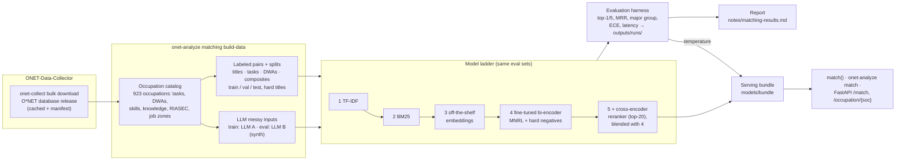

# data-science-onet

The **analytics half** of a two-repository O*NET pipeline. It consumes the tidy
tables produced by [ONET-Data-Collector](https://github.com/Benjamin-V-Chan/ONET-Data-Collector)
and turns them into diagnostics and interpretable structure:

- **EDA** — SOC-code coverage and occupation-distribution stats + plots.
- **Clustering** — group occupations into role families via TF-IDF → TruncatedSVD → KMeans.
- **Keyword attribution** — measure where each search keyword lands across the condensed feature fields.
- **Semantic occupation matching** — map *any* free text about work (titles, postings, experience,
  projects, interests, skill lists) to O*NET occupations with calibrated confidence and
  skill/interest profiles; Python API, CLI and HTTP service. See [below](#semantic-occupation-matching).

Everything is packaged as `onet_analysis` with a single `onet-analyze` CLI.

## Background

This project was originally built in 2024 as an open-source edtech tool for
analyzing O*NET occupational data at scale, and as part of my capstone project
for an engineering course. Its analytics pipeline (EDA, occupation clustering,
and keyword attribution) was later integrated into production products at
**Project Leo**, and has inspired related work at other companies and projects.

Since its original release, the project has been refined and modernized into a
packaged, tested Python library with a unified CLI.

---

---

## How it fits together

```
        ONET-Data-Collector                     data-science-onet (this repo)
  ┌───────────────────────────┐          ┌──────────────────────────────────────┐
  │ search → details → condense│  CSV /   │ EDA  ·  clustering  ·  keyword attrib. │
  │  (onet_data_collector pkg) │──JSON──▶ │        (onet_analysis pkg)            │
  └───────────────────────────┘          └──────────────────────────────────────┘
```

This repo depends on the collector package and re-exposes its ETL stage through
`onet-analyze collect`, so both repositories share exactly one implementation of
the API logic.

---

## Install

```bash
git clone https://github.com/Benjamin-V-Chan/data-science-onet.git
cd data-science-onet
python -m venv .venv && source .venv/bin/activate

# Install the collector (sibling repo) — editable local checkout is best for dev:
pip install -e ../ONET-Data-Collector
#   ...or from Git:  pip install "onet_data_collector @ git+https://github.com/Benjamin-V-Chan/ONET-Data-Collector.git"

pip install -e ".[dev]"     # installs onet_analysis + the `onet-analyze` command
```

`requirements.txt` pins the same set (including a Git reference to the collector)
so `pip install -r requirements.txt` works standalone.

## Credentials

Only the collection stage needs O*NET credentials (free signup at
<https://services.onetcenter.org/developer/signup>). Set `ONET_USERNAME` /
`ONET_PASSWORD`, use a `.env` file (see `.env.example`), or pass
`--username/--password`.

---

## Usage

```bash
# 1. Collect (hits the O*NET API) — writes data/raw and data/processed
onet-analyze collect "healthcare" "technology" "design"

# 2. Analyze the collected data (no network needed)
onet-analyze eda                 # coverage + distribution tables and plots
onet-analyze keywords            # keyword → field attribution matrix + charts
onet-analyze cluster --clusters 6  # role clusters + top terms + scatter plot

# ...or everything at once
onet-analyze all "healthcare" "technology" --clusters 6
```

Use `--base <dir>` to relocate the `data/` and `results/` trees.

### As a library

```python
from onet_analysis.loading import load_csv
from onet_analysis.eda import run_eda
from onet_analysis.clustering import cluster_occupations, plot_clusters
from onet_analysis.keyword_attribution import analyze_keywords

data = load_csv("data/raw/keyword_search_results.csv")
run_eda(data, out_dir="results", processed_dir="data/processed")

result = cluster_occupations(data, n_clusters=6)
plot_clusters(result, "results/occupation_clusters.png")
print(result.top_terms)          # distinctive terms per cluster
```

---

## Outputs

```
data/processed/  soc_code_coverage.csv, occupation_distribution.csv, cluster_assignments.csv
data/results/    keyword_analysis_results.csv, per-keyword bar charts
results/         soc_code_distribution.png, unique_soc_per_keyword.png,
                 occupation_clusters.png, keyword_search_evaluation_summary.txt
```

---

## Semantic occupation matching

`onet_analysis.matching` takes **any free text about work** and returns the
closest O*NET occupations, each with a calibrated confidence, its key tasks,
skills and knowledge, plus a profile of skills / knowledge / RIASEC interests
aggregated across the matches (weighted by O*NET importance ratings).

Job titles are only one input type. The same model handles all of these:

| input | example |
|---|---|
| job title | `Sr. Backend Eng II` |
| messy job description / posting | `Looking for someone to keep our trucks on the road, diesel exp a plus` |
| past experience | `ran the robotics club's CAD team` |
| project | `built a weather station with an Arduino and logged the data online` |
| interests / strengths | `I love drawing and figuring out how machines work` |
| skill list | `Excel, QuickBooks, payroll, AP/AR` |

```python
from onet_analysis.matching import match

result = match("I love drawing and figuring out how machines work", top_k=5)
for m in result.matches:
    print(m.soc, m.title, m.confidence, m.top_skills[:3])
print(result.profile["riasec_code"], result.profile["skills"][:5])
```

```bash
onet-analyze match "ran the robotics club's CAD team"       # CLI
onet-analyze serve --bundle models/bundle                     # HTTP: POST /match, GET /occupation/{soc}
```

The HTTP contract is in [docs/API.md](docs/API.md). Use cases are in
[docs/APPLICATIONS.md](docs/APPLICATIONS.md): EdTech career exploration, resume
parsing, job-posting normalization, workforce analytics and career counseling.

### Headline results

<!-- HEADLINE:BEGIN (pasted from notes/matching-results.md; every number names its run in outputs/runs/) -->
Served model: `L5b_ft-bge-base+synth+ce+fuse` (best validation top-1, then MRR, among the ladder runs).

**Real O*NET held-out test** (titles, tasks, activities, descriptions):

| model | run | n | top-1 | top-5 | MRR@20 | major-group top-1 | ECE | Δ top-1 vs TF-IDF (pp) | p50 latency (ms) |
|---|---|---|---|---|---|---|---|---|---|
| 1 TF-IDF (existing approach, baseline) | `L1_tfidf` | 6792 | 20.5 | 40.5 | 0.295 | 47.0 | 0.066 |  | 0.5 |
| 2 BM25 | `L2_bm25` | 6792 | 20.7 | 40.1 | 0.294 | 47.3 | 0.041 | +0.2 | 0.2 |
| 3a all-MiniLM-L6-v2 (off-the-shelf) | `L3_minilm` | 6792 | 31.7 | 59.2 | 0.439 | 59.6 | 0.053 | +11.2 | 3.1 |
| 3b bge-small-en-v1.5 (off-the-shelf) | `L3_bge-small` | 6792 | 32.9 | 59.4 | 0.447 | 60.3 | 0.062 | +12.4 | 5.5 |
| 3c bge-base-en-v1.5 (off-the-shelf) | `L3_bge-base` | 6792 | 36.1 | 64.3 | 0.485 | 63.3 | 0.053 | +15.6 | 6.9 |
| 3d e5-base-v2 (off-the-shelf) | `L3_e5-base` | 6792 | 35.5 | 63.8 | 0.479 | 63.4 | 0.052 | +15.0 | 6.8 |
| 4 fine-tuned bge-small (real data) | `L4_ft-bge-small` | 6792 | 45.6 | 73.7 | 0.581 | 72.3 | 0.028 | +25.1 | 5.2 |
| 5 = 4 + cross-encoder reranker (blended) | `L5_ft-bge-small+ce+fuse` | 6792 | 47.3 | 75.4 | 0.596 | 73.3 | 0.049 | +26.8 | 44.7 |
| 4s fine-tuned bge-small (real + synthetic) | `L4s_ft-bge-small+synth` | 6792 | 45.6 | 73.7 | 0.582 | 72.6 | 0.029 | +25.1 | 5.4 |
| 5s = 4s + cross-encoder reranker (blended) | `L5s_ft-bge-small+synth+ce+fuse` | 6792 | 47.6 | 75.6 | 0.599 | 73.5 | 0.037 | +27.1 | 44.8 |
| 4b fine-tuned bge-base (real + synthetic) | `L4b_ft-bge-base+synth` | 6792 | 50.2 | 78.2 | 0.624 | 75.2 | 0.024 | +29.7 | 6.8 |
| 5b = 4b + cross-encoder reranker (blended) | `L5b_ft-bge-base+synth+ce+fuse` | 6792 | 51.1 | 79.1 | 0.633 | 75.4 | 0.037 | +30.6 | 46.7 |

**Held-out LLM-written messy inputs** (`synthetic_test`, written by a different model than the training data):

| model | run | n | top-1 | top-5 | MRR@20 | major-group top-1 | ECE | Δ top-1 vs TF-IDF (pp) | p50 latency (ms) |
|---|---|---|---|---|---|---|---|---|---|
| 1 TF-IDF (existing approach, baseline) | `L1_tfidf` | 4703 | 17.4 | 39.2 | 0.274 | 42.3 | 0.038 |  | 0.5 |
| 2 BM25 | `L2_bm25` | 4703 | 24.1 | 45.2 | 0.338 | 51.0 | 0.084 | +6.7 | 0.2 |
| 3a all-MiniLM-L6-v2 (off-the-shelf) | `L3_minilm` | 4703 | 34.3 | 66.3 | 0.480 | 63.0 | 0.043 | +16.9 | 3.1 |
| 3b bge-small-en-v1.5 (off-the-shelf) | `L3_bge-small` | 4703 | 37.1 | 69.5 | 0.514 | 65.7 | 0.074 | +19.8 | 5.5 |
| 3c bge-base-en-v1.5 (off-the-shelf) | `L3_bge-base` | 4703 | 45.4 | 77.6 | 0.595 | 72.4 | 0.117 | +28.1 | 6.9 |
| 3d e5-base-v2 (off-the-shelf) | `L3_e5-base` | 4703 | 42.2 | 75.8 | 0.568 | 70.5 | 0.132 | +24.8 | 6.8 |
| 4 fine-tuned bge-small (real data) | `L4_ft-bge-small` | 4703 | 43.1 | 76.8 | 0.579 | 71.8 | 0.040 | +25.7 | 5.2 |
| 5 = 4 + cross-encoder reranker (blended) | `L5_ft-bge-small+ce+fuse` | 4703 | 45.4 | 78.5 | 0.597 | 73.1 | 0.022 | +28.0 | 44.7 |
| 4s fine-tuned bge-small (real + synthetic) | `L4s_ft-bge-small+synth` | 4703 | 57.9 | 88.5 | 0.714 | 83.0 | 0.079 | +40.5 | 5.4 |
| 5s = 4s + cross-encoder reranker (blended) | `L5s_ft-bge-small+synth+ce+fuse` | 4703 | 59.0 | 89.3 | 0.720 | 82.9 | 0.086 | +41.6 | 44.8 |
| 4b fine-tuned bge-base (real + synthetic) | `L4b_ft-bge-base+synth` | 4703 | 65.2 | 92.6 | 0.772 | 85.8 | 0.090 | +47.9 | 6.8 |
| 5b = 4b + cross-encoder reranker (blended) | `L5b_ft-bge-base+synth+ce+fuse` | 4703 | 65.4 | 92.9 | 0.774 | 85.8 | 0.102 | +48.1 | 46.7 |

<!-- HEADLINE:END -->

Full tables for each input type, calibration, learning curves, ablations and
error analysis are in `notes/matching-results.md`, generated by
`onet-analyze matching report`.

### Architecture



The occupation documents that models search are built from the title,
description and top tasks. Every validation and test task is removed from them,
so no test text is visible to a model. Confidence is a softmax over the top-20
scores with a temperature fitted on the real validation split.

### Reproduce

```bash
pip install -e ../ONET-Data-Collector && pip install -e ".[dev]"   # dev pulls matching/serve/synth extras

onet-analyze matching build-data            # download O*NET 31.0 (no credentials), build catalog + datasets
scripts/matching/reproduce.sh               # full real-data ladder + ablations + report
# Synthetic messy inputs need API keys (see docs/SYNTHETIC_DATA.md):
WITH_SYNTH=1 TRAIN_LLM=claude-opus-5-5 EVAL_PROVIDER=anthropic EVAL_LLM=claude-sonnet-5-5 scripts/matching/reproduce.sh

# Individual steps
onet-analyze matching eval tfidf --run-name L1_tfidf
onet-analyze matching eval dense=BAAI/bge-base-en-v1.5 --run-name L3_bge-base
onet-analyze matching train-biencoder --name L4_ft-bge-small --eval
onet-analyze matching train-reranker --name L5_ft-bge-small+ce --biencoder models/L4_ft-bge-small --eval
onet-analyze matching tune-fusion "dense=models/L4_ft-bge-small+rerank=models/L5_ft-bge-small+ce" \
    --eval-as L5_ft-bge-small+ce+fuse      # blend weight chosen on validation
# served model: bge-base bi-encoder (real + synthetic) blended with the 5s reranker
onet-analyze matching train-biencoder --name L4b_ft-bge-base+synth --base-model BAAI/bge-base-en-v1.5 \
    --batch-size 32 --sources title,task,dwa,composite,synthetic --eval
onet-analyze matching tune-fusion "dense=models/L4b_ft-bge-base+synth+rerank=models/L5s_ft-bge-small+synth+ce" \
    --eval-as L5b_ft-bge-base+synth+ce+fuse
onet-analyze matching bundle "<spec from the chosen run's config.json>" --run <run>
onet-analyze matching report
```

The exact scripts behind every saved run are `scripts/matching/run_offtheshelf.sh`,
`run_finetune.sh`, `reeval_ladder.sh` and `reproduce.sh`. On an Apple M5 Pro
(MPS, bf16) one epoch of bge-small took 26 minutes on the real pairs and 31
minutes with the synthetic data added, bge-base with the synthetic data took
58 minutes (batch 32), and the reranker took 24 minutes (times from each
model's `training.json`). Docker: see [docs/API.md](docs/API.md).

---

## Method notes (what's real, and why)

- **TF-IDF (unigrams + bigrams)** over occupation titles (and descriptions when
  present) is a transparent, dependency-light baseline — no GPU or model
  download — whose vocabulary makes clusters explainable via top terms.
- **TruncatedSVD (LSA)** reduces the *sparse* TF-IDF matrix without densifying
  it: memory-safe, and the correct PCA analogue for sparse text.
- **KMeans** with fixed `random_state`/`n_init` gives stable, repeatable
  groupings; a silhouette score is reported and `k` is auto-clamped to the
  sample count so tiny inputs never crash.
- **Schema tolerance** — column resolution accepts naming variants
  (`Job Title` / `job_title` / `occupation_title`, etc.) so analysis survives
  export drift.
- These are interpretable **baselines**, chosen deliberately for
  explainability and zero heavy dependencies. The semantic matcher above
  benchmarks the same TF-IDF setup against embedding models, and the heavier
  dependencies are opt-in extras (`[matching]`, `[serve]`, `[synth]`).

The core install depends only on `pandas`, `numpy`, `scikit-learn`,
`matplotlib`, `pyarrow` and (optionally) `seaborn`. PyTorch and
sentence-transformers are only needed for dense matching models
(`pip install -e ".[matching]"`).

---

## Development

```bash
pip install -e ".[dev]"
pytest            # all offline: synthetic fixtures, a tiny local BERT, a mocked LLM
```

Legacy scripts under `scripts/` are kept for backwards compatibility and now
delegate to the `onet_analysis` package; prefer the `onet-analyze` CLI.

## License

MIT — see [LICENSE](LICENSE).
