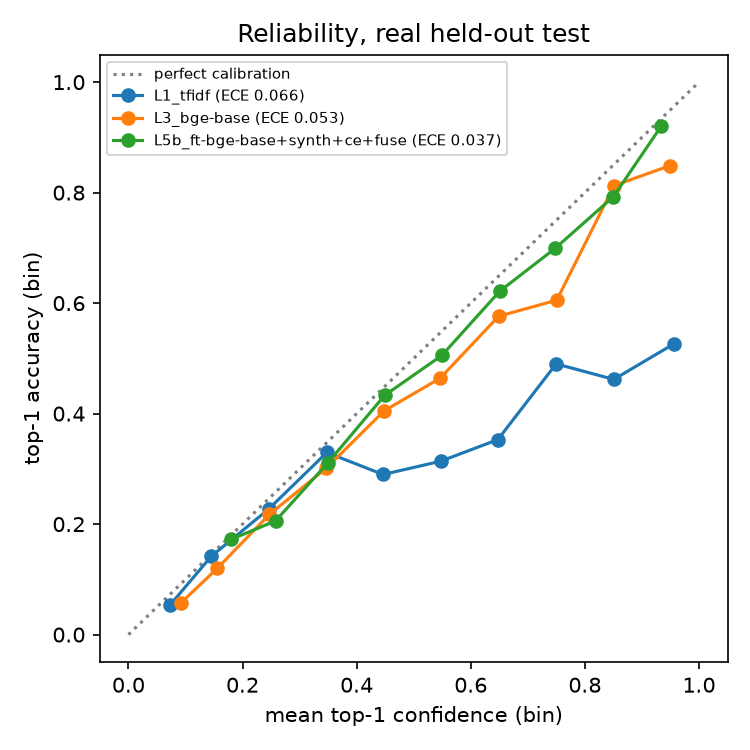
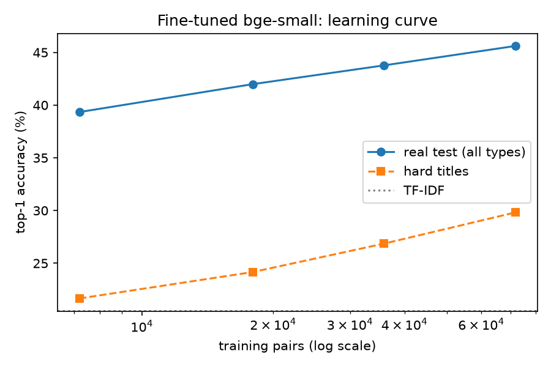

# Semantic occupation matching — results

_Generated by `onet-match matching report` from `outputs/runs/*/metrics.json`; do not edit by hand._
_Every table names the run directory its numbers come from._

O*NET release: **31.0** (sha256 `6883548adf5f…`, downloaded 2026-10-23T10:57:46.142453+00:00). Match targets: **923** occupations.

## Key findings

- **Best model** (`L5b_ft-bge-base+synth+ce+fuse`): real-test top-1 51.1% vs 20.5% for TF-IDF (+30.6 pp); held-out messy inputs 65.4% vs 17.4% (+48.1 pp).
- Off-the-shelf embeddings (`L3_bge-base` vs `L1_tfidf`, real_test): top-1 20.5% → 36.1% (+15.6 pp).
- Fine-tuning bge-small on O*NET pairs (`L4_ft-bge-small` vs `L3_bge-small`, real_test): top-1 32.9% → 45.6% (+12.7 pp).
- Blending in the reranker (`L5_ft-bge-small+ce+fuse` vs `L4_ft-bge-small`, real_test): top-1 45.6% → 47.3% (+1.7 pp).
- Adding synthetic messy training text (`L4s_ft-bge-small+synth` vs `L4_ft-bge-small`, synthetic_test): top-1 43.1% → 57.9% (+14.9 pp).
- Adding synthetic messy training text (`L4s_ft-bge-small+synth` vs `L4_ft-bge-small`, real_test): top-1 45.6% → 45.6% (±0.0 pp).
- Fine-tuning bge-base instead of bge-small (`L4b_ft-bge-base+synth` vs `L4s_ft-bge-small+synth`, real_test): top-1 45.6% → 50.2% (+4.6 pp).
- Fine-tuning bge-base instead of bge-small (`L4b_ft-bge-base+synth` vs `L4s_ft-bge-small+synth`, synthetic_test): top-1 57.9% → 65.2% (+7.3 pp).
- Hard-negative mining (`L4_ft-bge-small` vs `abl_hardneg_off`, real_test): top-1 45.2% → 45.6% (+0.4 pp).
- Reranker score alone (no blending) (`L5_ft-bge-small+ce` vs `L4_ft-bge-small`, real_test): top-1 45.6% → 38.9% (-6.7 pp).
- Learning curve (real-test top-1 at 10%, 25%, 50%, 100% of the real pairs): 39.3 → 42.0 → 43.8 → 45.6, still rising at full data.
- By input type, the best model is strongest on `description` (81.0% top-1) and weakest on `task` (37.6%, top-5 67.0%).

## Data

Rows per source and split (unique normalised texts; see `onet_analysis/matching/datasets.py`):

```json
{
 "composite": {
  "test": 865,
  "train": 9133,
  "val": 886
 },
 "dwa": {
  "test": 208,
  "train": 1669,
  "val": 208
 },
 "task": {
  "test": 1762,
  "train": 14054,
  "val": 1762
 },
 "title": {
  "test": 3957,
  "train": 31559,
  "val": 3957
 },
 "title_hard": {
  "train": 12324,
  "val": 1542,
  "test": 1556
 },
 "multi_label_rows": 6964,
 "n_occupations": 923
}
```

## Model ladder

Top-1 / top-5 = a gold occupation is ranked 1st / in the top 5. MRR@20 over the top-20 candidates. Major-group top-1 = the top prediction is in a gold occupation's SOC major group. ECE = expected calibration error of the top-1 confidence (10 bins). Latency = single-query p50.

### Real O*NET held-out test (`real_test`)

| model | run | n | top-1 | top-5 | MRR@20 | major-group top-1 | ECE | Δ top-1 vs TF-IDF (pp) | p50 latency (ms) |
|---|---|---|---|---|---|---|---|---|---|
| 1 TF-IDF (existing approach, baseline) | `L1_tfidf` | 6792 | 20.5 | 40.5 | 0.295 | 47.0 | 0.066 |  | 0.5 |
| 2 BM25 | `L2_bm25` | 6792 | 20.7 | 40.1 | 0.294 | 47.3 | 0.041 | +0.2 | 0.2 |
| 3a all-MiniLM-L6-v2 (off-the-shelf) | `L3_minilm` | 6792 | 31.7 | 59.2 | 0.439 | 59.6 | 0.053 | +11.2 | 3.1 |
| 3b bge-small-en-v1.5 (off-the-shelf) | `L3_bge-small` | 6792 | 32.9 | 59.4 | 0.447 | 60.3 | 0.062 | +12.4 | 5.5 |
| 3c bge-base-en-v1.5 (off-the-shelf) | `L3_bge-base` | 6792 | 36.1 | 64.3 | 0.485 | 63.3 | 0.053 | +15.6 | 6.9 |
| 3d e5-base-v2 (off-the-shelf) | `L3_e5-base` | 6792 | 35.5 | 63.8 | 0.479 | 63.4 | 0.052 | +15.0 | 6.8 |
| 4 fine-tuned bge-small (real data) | `L4_ft-bge-small` | 6792 | 45.6 | 73.7 | 0.581 | 72.3 | 0.028 | +25.1 | 5.2 |
| 5 = 4 + cross-encoder reranker (blended) | `L5_ft-bge-small+ce+fuse` | 6792 | 47.3 | 75.4 | 0.596 | 73.3 | 0.049 | +26.8 | 44.7 |
| 4s fine-tuned bge-small (real + synthetic) | `L4s_ft-bge-small+synth` | 6792 | 45.6 | 73.7 | 0.582 | 72.6 | 0.029 | +25.1 | 5.4 |
| 5s = 4s + cross-encoder reranker (blended) | `L5s_ft-bge-small+synth+ce+fuse` | 6792 | 47.6 | 75.6 | 0.599 | 73.5 | 0.037 | +27.1 | 44.8 |
| 4b fine-tuned bge-base (real + synthetic) | `L4b_ft-bge-base+synth` | 6792 | 50.2 | 78.2 | 0.624 | 75.2 | 0.024 | +29.7 | 6.8 |
| 5b = 4b + cross-encoder reranker (blended) | `L5b_ft-bge-base+synth+ce+fuse` | 6792 | 51.1 | 79.1 | 0.633 | 75.4 | 0.037 | +30.6 | 46.7 |

Top-1 by input type:

| model | job_title (n=3957) | description (n=865) | task (n=1762) | activity (n=208) | hard titles (n=1556) |
|---|---|---|---|---|---|
| 1 TF-IDF (existing approach, baseline) | 15.6 | 35.0 | 22.9 | 32.7 | 6.5 |
| 2 BM25 | 15.0 | 35.7 | 23.7 | 40.9 | 6.6 |
| 3a all-MiniLM-L6-v2 (off-the-shelf) | 32.5 | 38.2 | 26.6 | 34.1 | 16.6 |
| 3b bge-small-en-v1.5 (off-the-shelf) | 35.4 | 37.5 | 24.8 | 35.6 | 16.5 |
| 3c bge-base-en-v1.5 (off-the-shelf) | 39.2 | 38.6 | 27.8 | 36.5 | 20.5 |
| 3d e5-base-v2 (off-the-shelf) | 40.1 | 36.3 | 24.9 | 33.7 | 21.4 |
| 4 fine-tuned bge-small (real data) | 50.1 | 50.3 | 34.3 | 36.5 | 29.8 |
| 5 = 4 + cross-encoder reranker (blended) | 52.9 | 49.9 | 34.1 | 41.3 | 31.2 |
| 4s fine-tuned bge-small (real + synthetic) | 50.0 | 49.9 | 34.3 | 38.5 | 30.1 |
| 5s = 4s + cross-encoder reranker (blended) | 53.3 | 49.8 | 34.5 | 41.8 | 31.7 |
| 4b fine-tuned bge-base (real + synthetic) | 55.4 | 53.5 | 37.9 | 40.4 | 38.3 |
| 5b = 4b + cross-encoder reranker (blended) | 57.1 | 53.1 | 37.6 | 40.9 | 38.1 |

MRR@20 by input type:

| model | job_title (n=3957) | description (n=865) | task (n=1762) | activity (n=208) | hard titles (n=1556) |
|---|---|---|---|---|---|
| 1 TF-IDF (existing approach, baseline) | 0.226 | 0.477 | 0.339 | 0.474 | 0.106 |
| 2 BM25 | 0.220 | 0.479 | 0.340 | 0.541 | 0.108 |
| 3a all-MiniLM-L6-v2 (off-the-shelf) | 0.444 | 0.518 | 0.385 | 0.482 | 0.266 |
| 3b bge-small-en-v1.5 (off-the-shelf) | 0.468 | 0.509 | 0.365 | 0.483 | 0.265 |
| 3c bge-base-en-v1.5 (off-the-shelf) | 0.514 | 0.526 | 0.400 | 0.492 | 0.317 |
| 3d e5-base-v2 (off-the-shelf) | 0.519 | 0.503 | 0.377 | 0.472 | 0.318 |
| 4 fine-tuned bge-small (real data) | 0.619 | 0.640 | 0.474 | 0.517 | 0.430 |
| 5 = 4 + cross-encoder reranker (blended) | 0.643 | 0.638 | 0.474 | 0.559 | 0.445 |
| 4s fine-tuned bge-small (real + synthetic) | 0.620 | 0.639 | 0.475 | 0.529 | 0.435 |
| 5s = 4s + cross-encoder reranker (blended) | 0.646 | 0.638 | 0.477 | 0.563 | 0.451 |
| 4b fine-tuned bge-base (real + synthetic) | 0.671 | 0.668 | 0.506 | 0.545 | 0.524 |
| 5b = 4b + cross-encoder reranker (blended) | 0.687 | 0.667 | 0.506 | 0.558 | 0.525 |

### Held-out LLM-generated messy inputs (`synthetic_test`)

| model | run | n | top-1 | top-5 | MRR@20 | major-group top-1 | ECE | Δ top-1 vs TF-IDF (pp) | p50 latency (ms) |
|---|---|---|---|---|---|---|---|---|---|
| 1 TF-IDF (existing approach, baseline) | `L1_tfidf` | 4703 | 17.4 | 39.2 | 0.274 | 42.3 | 0.038 |  | 0.5 |
| 2 BM25 | `L2_bm25` | 4703 | 24.1 | 45.2 | 0.338 | 51.0 | 0.084 | +6.7 | 0.2 |
| 3a all-MiniLM-L6-v2 (off-the-shelf) | `L3_minilm` | 4703 | 34.3 | 66.3 | 0.480 | 63.0 | 0.043 | +16.9 | 3.1 |
| 3b bge-small-en-v1.5 (off-the-shelf) | `L3_bge-small` | 4703 | 37.1 | 69.5 | 0.514 | 65.7 | 0.074 | +19.8 | 5.5 |
| 3c bge-base-en-v1.5 (off-the-shelf) | `L3_bge-base` | 4703 | 45.4 | 77.6 | 0.595 | 72.4 | 0.117 | +28.1 | 6.9 |
| 3d e5-base-v2 (off-the-shelf) | `L3_e5-base` | 4703 | 42.2 | 75.8 | 0.568 | 70.5 | 0.132 | +24.8 | 6.8 |
| 4 fine-tuned bge-small (real data) | `L4_ft-bge-small` | 4703 | 43.1 | 76.8 | 0.579 | 71.8 | 0.040 | +25.7 | 5.2 |
| 5 = 4 + cross-encoder reranker (blended) | `L5_ft-bge-small+ce+fuse` | 4703 | 45.4 | 78.5 | 0.597 | 73.1 | 0.022 | +28.0 | 44.7 |
| 4s fine-tuned bge-small (real + synthetic) | `L4s_ft-bge-small+synth` | 4703 | 57.9 | 88.5 | 0.714 | 83.0 | 0.079 | +40.5 | 5.4 |
| 5s = 4s + cross-encoder reranker (blended) | `L5s_ft-bge-small+synth+ce+fuse` | 4703 | 59.0 | 89.3 | 0.720 | 82.9 | 0.086 | +41.6 | 44.8 |
| 4b fine-tuned bge-base (real + synthetic) | `L4b_ft-bge-base+synth` | 4703 | 65.2 | 92.6 | 0.772 | 85.8 | 0.090 | +47.9 | 6.8 |
| 5b = 4b + cross-encoder reranker (blended) | `L5b_ft-bge-base+synth+ce+fuse` | 4703 | 65.4 | 92.9 | 0.774 | 85.8 | 0.102 | +48.1 | 46.7 |

Top-1 by input type:

| model | description (n=969) | experience (n=944) | project (n=929) | interest (n=924) | skills (n=937) |
|---|---|---|---|---|---|
| 1 TF-IDF (existing approach, baseline) | 24.7 | 19.9 | 14.0 | 6.1 | 21.8 |
| 2 BM25 | 35.7 | 25.7 | 20.5 | 7.9 | 29.9 |
| 3a all-MiniLM-L6-v2 (off-the-shelf) | 41.2 | 36.7 | 35.6 | 22.4 | 35.0 |
| 3b bge-small-en-v1.5 (off-the-shelf) | 47.8 | 41.8 | 36.1 | 23.4 | 36.0 |
| 3c bge-base-en-v1.5 (off-the-shelf) | 59.6 | 50.2 | 41.8 | 31.5 | 43.3 |
| 3d e5-base-v2 (off-the-shelf) | 51.7 | 44.2 | 40.7 | 29.5 | 44.3 |
| 4 fine-tuned bge-small (real data) | 55.5 | 45.2 | 40.3 | 26.4 | 47.2 |
| 5 = 4 + cross-encoder reranker (blended) | 59.2 | 48.7 | 40.0 | 27.4 | 50.8 |
| 4s fine-tuned bge-small (real + synthetic) | 72.7 | 63.5 | 49.7 | 44.4 | 58.6 |
| 5s = 4s + cross-encoder reranker (blended) | 73.7 | 63.5 | 52.7 | 43.9 | 60.2 |
| 4b fine-tuned bge-base (real + synthetic) | 80.8 | 69.5 | 56.0 | 53.6 | 65.5 |
| 5b = 4b + cross-encoder reranker (blended) | 81.0 | 69.5 | 57.5 | 51.4 | 67.0 |

MRR@20 by input type:

| model | description (n=969) | experience (n=944) | project (n=929) | interest (n=924) | skills (n=937) |
|---|---|---|---|---|---|
| 1 TF-IDF (existing approach, baseline) | 0.373 | 0.312 | 0.231 | 0.119 | 0.330 |
| 2 BM25 | 0.472 | 0.376 | 0.295 | 0.138 | 0.403 |
| 3a all-MiniLM-L6-v2 (off-the-shelf) | 0.556 | 0.509 | 0.492 | 0.360 | 0.480 |
| 3b bge-small-en-v1.5 (off-the-shelf) | 0.625 | 0.565 | 0.494 | 0.382 | 0.496 |
| 3c bge-base-en-v1.5 (off-the-shelf) | 0.723 | 0.644 | 0.559 | 0.471 | 0.572 |
| 3d e5-base-v2 (off-the-shelf) | 0.660 | 0.588 | 0.551 | 0.457 | 0.578 |
| 4 fine-tuned bge-small (real data) | 0.697 | 0.607 | 0.544 | 0.421 | 0.620 |
| 5 = 4 + cross-encoder reranker (blended) | 0.728 | 0.632 | 0.551 | 0.421 | 0.644 |
| 4s fine-tuned bge-small (real + synthetic) | 0.832 | 0.760 | 0.649 | 0.604 | 0.717 |
| 5s = 4s + cross-encoder reranker (blended) | 0.839 | 0.762 | 0.669 | 0.595 | 0.730 |
| 4b fine-tuned bge-base (real + synthetic) | 0.887 | 0.810 | 0.701 | 0.683 | 0.773 |
| 5b = 4b + cross-encoder reranker (blended) | 0.888 | 0.810 | 0.712 | 0.671 | 0.780 |

## Calibration

Confidence = softmax over the top-20 scores with one temperature fitted on the validation split (per run, stored in `metrics.json`).



## Learning curve

| fraction | train pairs | run | real top-1 | hard titles top-1 | train minutes |
|---|---|---|---|---|---|
| 0.1 | 7186 | `lc_frac0.1` | 39.3 | 21.7 | 2.6 |
| 0.25 | 17962 | `lc_frac0.25` | 42.0 | 24.2 | 6.4 |
| 0.5 | 35925 | `lc_frac0.5` | 43.8 | 26.9 | 12.8 |
| 1.0 | 71838 | `L4_ft-bge-small` | 45.6 | 29.8 | 26.1 |



## Ablations

### Occupation representation fields (off-the-shelf models, real test top-1)

| model | title | title+desc | title+desc+tasks | title+desc+tasks+skills |
|---|---|---|---|---|
| bm25 | 12.5 | 16.4 | 20.7 | 20.5 |
| bge-small | 27.5 | 31.0 | 32.9 | 32.9 |
| bge-base | 29.9 | 34.5 | 36.1 | 36.1 |

### Training-data sources (fine-tuned bge-small, hard negatives on)

| variant | run | bi-encoder train pairs | real_test top-1 | synthetic_test top-1 | hard titles top-1 |
|---|---|---|---|---|---|
| titles only | `abl_data_titles` | 37012 | 42.4 | 39.7 | 29.8 |
| + tasks, DWAs, composites (all real) | `L4_ft-bge-small` | 71838 | 45.6 | 43.1 | 29.8 |
| + synthetic messy inputs | `L4s_ft-bge-small+synth` | 86412 | 45.6 | 57.9 | 30.1 |

### Hard-negative mining (fine-tuned bge-small, all real sources)

| variant | run | bi-encoder train pairs | real_test top-1 | synthetic_test top-1 | hard titles top-1 |
|---|---|---|---|---|---|
| hard negatives off | `abl_hardneg_off` | 72124 | 45.2 | 43.5 | 29.5 |
| hard negatives on | `L4_ft-bge-small` | 71838 | 45.6 | 43.1 | 29.8 |

### Reranker scoring

The reranker rescores the bi-encoder's top 20. "Blended" ranks by a weighted sum of the two models' per-query z-scored scores; the weight is chosen on the validation split (`onet-match matching tune-fusion`, grid saved in `outputs/fusion/`).

| variant | run | bi-encoder train pairs | real_test top-1 | synthetic_test top-1 | hard titles top-1 |
|---|---|---|---|---|---|
| 4: bi-encoder only | `L4_ft-bge-small` | 71838 | 45.6 | 43.1 | 29.8 |
| 5: reranker score only | `L5_ft-bge-small+ce` | 71838 | 38.9 | 32.2 | 24.0 |
| 5: blended | `L5_ft-bge-small+ce+fuse` | 71838 | 47.3 | 45.4 | 31.2 |
| 4s: bi-encoder only | `L4s_ft-bge-small+synth` | 86412 | 45.6 | 57.9 | 30.1 |
| 5s: reranker score only | `L5s_ft-bge-small+synth+ce` | 86412 | 38.8 | 43.8 | 22.8 |
| 5s: blended | `L5s_ft-bge-small+synth+ce+fuse` | 86412 | 47.6 | 59.0 | 31.7 |

## Error analysis (best model by validation top-1, then MRR: `L5b_ft-bge-base+synth+ce+fuse`)

Randomly sampled wrong top-1 predictions on the real test set:

| input type | input | gold | predicted (top-1) | confidence | gold in top-5 |
|---|---|---|---|---|---|
| activity | Discuss goods or services information with customers or patrons. | Crematory Operators; Customer Service Representatives; Hotel, Motel, and Resort Desk Clerks | Cashiers | 0.65 | no |
| activity | Read materials to determine needed actions. | Broadcast Technicians; First-Line Supervisors of Correctional Officers; Correspondence Clerks | Explosives Workers, Ordnance Handling Experts, and Blasters | 0.46 | no |
| activity | Market products, services, or events. | Agents and Business Managers of Artists, Performers, and Athletes; Meeting, Convention, and Event Planners; Online Merchants | Fundraisers | 0.29 | no |
| description | Administer medication, immunizations, or blood plasma to animals as prescribed by veterinarians. Perform enemas, catheterizations, ear flushes, intravenous f... | Veterinary Assistants and Laboratory Animal Caretakers | Veterinary Technologists and Technicians | 0.61 | yes |
| description | Locate and attach appropriate files to incoming correspondence requiring replies. Coordinate conferences, meetings, or special events, such as luncheons or g... | Secretaries and Administrative Assistants, Except Legal, Medical, and Executive | Executive Secretaries and Executive Administrative Assistants | 0.57 | yes |
| description | Prepare geometric layouts from graphic displays, using computer-assisted drafting software or drafting instruments and graph paper. Modify existing programs ... | Computer Numerically Controlled Tool Programmers | Architectural and Civil Drafters | 0.31 | no |
| job_title | Brick Picker | Inspectors, Testers, Sorters, Samplers, and Weighers | Brickmasons and Blockmasons | 0.39 | no |
| job_title | Ship Erector | Layout Workers, Metal and Plastic | Structural Iron and Steel Workers | 0.30 | yes |
| job_title | On-Air Director | Producers and Directors | Media Programming Directors | 0.51 | yes |
| task | Remove or cut out defective parts or drill holes to gain access to internal defects or damage, using drills and punches. | Aircraft Mechanics and Service Technicians | Mobile Heavy Equipment Mechanics, Except Engines | 0.17 | no |
| task | Keep records of work orders and test and maintenance reports. | Audiovisual Equipment Installers and Repairers | Electrical and Electronics Repairers, Powerhouse, Substation, and Relay | 0.36 | no |
| task | Plan or conduct experiments to validate new materials, optimize startup protocols, reduce conditioning time, or examine contaminant tolerance. | Fuel Cell Engineers | Chemical Technicians | 0.19 | no |

Most frequent major-group confusions (wrong major group at top-1):

| gold major group | predicted major group | count |
|---|---|---|
| 51 Production | 47 Construction and Extraction | 52 |
| 53 Transportation and Material Moving | 51 Production | 48 |
| 51 Production | 53 Transportation and Material Moving | 45 |
| 11 Management | 13 Business and Financial Operations | 43 |
| 47 Construction and Extraction | 51 Production | 34 |
| 51 Production | 49 Installation, Maintenance, and Repair | 32 |
| 49 Installation, Maintenance, and Repair | 51 Production | 32 |
| 49 Installation, Maintenance, and Repair | 47 Construction and Extraction | 27 |

Failures on held-out synthetic messy inputs:

| input type | input | gold | predicted (top-1) | confidence | gold in top-5 |
|---|---|---|---|---|---|
| description | Night shift tank farm hand needed at our terminal off Route 9. You'll run the transfer equipment that moves product between storage tanks, trucks and rail ca... | Pump Operators, Except Wellhead Pumpers | Tank Car, Truck, and Ship Loaders | 0.57 | yes |
| description | Looking for a reliable crane-and-cable guy/gal for our quarry crew in Tulsa. You'll run the big drum lift rigs that haul material up and down the pit, watchi... | Hoist and Winch Operators | Crane and Tower Operators | 0.39 | yes |
| experience | Worked 4 years at a poultry and hog processing plant in Iowa. Started on the line cleaning and prepping carcasses, then moved to the cutting room trimming lo... | Slaughterers and Meat Packers | Meat, Poultry, and Fish Cutters and Trimmers | 0.53 | yes |
| experience | Spent 3 yrs at a county detox center doing intake interviews, running relapse-prevention groups and following up with clients after discharge to make sure th... | Mental Health and Substance Abuse Social Workers | Substance Abuse and Behavioral Disorder Counselors | 0.55 | yes |
| interest | I've always been fascinated by trains and big machines that haul heavy loads. I like jobs where I'm outside, working with a team, and paying close attention ... | Rail Yard Engineers, Dinkey Operators, and Hostlers | Loading and Moving Machine Operators, Underground Mining | 0.32 | no |
| interest | I'm not much for sitting at a desk, I like working outside with my hands and seeing something solid built by the end of the day. Stone walls and old brick bu... | Helpers--Brickmasons, Blockmasons, Stonemasons, and Tile and Marble Setters | Stonemasons | 0.44 | yes |
| project | For my business class I built a mock marketing plan to sell a rundown duplex, including comps, a pricing strategy, listing photos and a video walkthrough for... | Real Estate Brokers | Real Estate Sales Agents | 0.44 | no |
| project | Last summer I rewired my church's sanctuary sound system, swapping out old speakers, labeling all the cables, and tuning the mixer so the back pews could fin... | Audiovisual Equipment Installers and Repairers | Audio and Video Technicians | 0.31 | yes |
| skills | report writing | Budget Analysts | Writers and Authors | 0.39 | no |
| skills | staff scheduling, training new hires, POS systems, cash handling/till reconciliation, ServSafe Food Handler, customer complaint resolution, inventory orderin... | First-Line Supervisors of Food Preparation and Serving Workers | Food Service Managers | 0.45 | yes |

## Limitations

- **Label granularity and ambiguity.** Many titles and generic activities legitimately map to several
  occupations; we score a hit when the prediction is any of the O*NET-listed codes, but O*NET's lists are
  not exhaustive, so some "errors" are defensible answers (see the error table).
- **Real-data eval sets are O*NET's own language.** Held-out titles and tasks are realistic for job-title
  normalization but are cleaner than what people type; the synthetic set exists to measure
  messy inputs, but it is still LLM-written.
- **No human-written test set yet.** Messy-input results come from LLM-written text only. Both synthetic
  sets were written by Claude models (Opus for training, Sonnet for evaluation): different models, same
  vendor, so some shared phrasing may flatter the synthetic-test numbers.
- **Residual occupations are excluded.** O*NET-SOC codes without task data (mostly "..., All Other")
  are not match targets.
- **Calibration is fitted on O*NET-style validation data.** Confidence is temperature-scaled on the real
  validation split; on input styles far from it (e.g. very short interest statements) the reliability curve
  per set is the thing to check before thresholding on confidence.
- **One training run per configuration** (seed 13). Differences of about a point or less, such as hard
  negatives on vs off, are within run-to-run noise and should not be read as real effects.
- **English, US taxonomy.** O*NET is US-specific and English-only.
- **Latency** is single-query wall-clock on an Apple-silicon laptop (MPS), excluding HTTP overhead.
